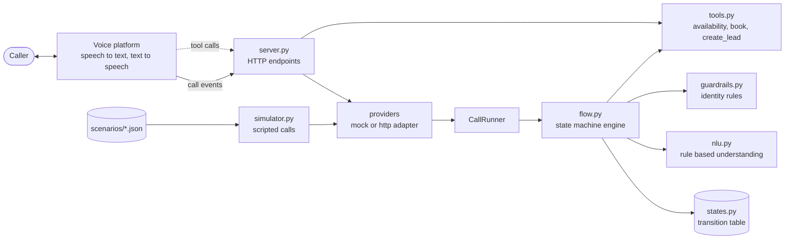
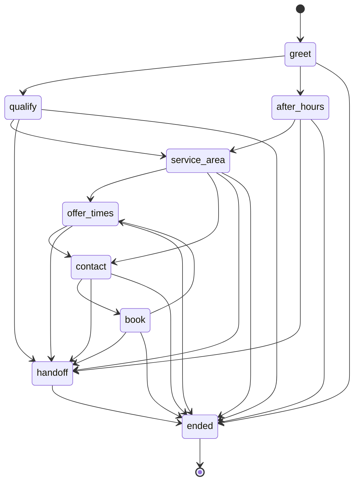

# ai-receptionist-starter

Small home services companies miss calls while everyone is on a job, and a missed call is usually a lost job.
Most "AI receptionist" demos are one long prompt, which makes them hard to test and easy to derail.

This starter is a voice AI receptionist built the other way around: the call flow is an explicit state machine, the things it can do are three small tools, and everything runs offline against a mock voice provider so you can test a call the same way you test any other code.

The assistant always says it is an automated assistant and never claims to be a person. That rule is enforced in code on every line it speaks, not left to a prompt.

## What it does

- **Call flow as a state machine.** Greet, qualify the job, check the service area, offer arrival windows, collect contact details, book, hand off to a human, and a separate after hours path. Every allowed transition is listed in one table in `receptionist/states.py`, and the engine refuses any move that is not in it.
- **Three tools.** `availability`, `book` and `create_lead`, usable in process or over HTTP as endpoints a voice platform calls. Booking is idempotent and rejects double bookings.
- **Voice provider adapter.** A small `VoiceProvider` contract with two implementations: a mock that records everything, and a generic HTTP adapter that needs an API key. The mock is the default, so nothing needs a key.
- **Call simulator.** Scripted fake calls in `scenarios/*.json` are played through the real flow. It prints the transcript, every state change, every tool call and the outcome, and exits non-zero if a call does not end the way the scenario expects.
- **Identity guardrail.** The first line of every call must contain the disclosure. Any line that claims to be a person raises an error before it is spoken. Asking "are you a real person?" gets a straight answer in any state, then the call carries on where it was.
- **Sensible escalation.** Two misses in a row in any state and the assistant stops guessing and hands off. An emergency goes straight to a transfer. Every handoff, hang up and dead end leaves a lead behind with whatever was collected.

## Architecture



The call flow itself, generated from the transition table by `mermaid()` in `receptionist/states.py`:



| State | What happens | Leaves when |
| --- | --- | --- |
| `greet` | Discloses the assistant, routes on business hours | Always, immediately |
| `qualify` | Works out the job type | Job recognised, or two misses (handoff) |
| `after_hours` | Office closed: take a message, or escalate an emergency | Message given |
| `service_area` | Checks the ZIP code | In area, or out of area (call ends, lead saved) |
| `offer_times` | Offers three arrival windows, then three more | Window picked, or nothing fits (callback request) |
| `contact` | Name and callback number | Both collected |
| `book` | Reads the booking back and books on a yes | Booked, or the window was taken (back to offers) |
| `handoff` | Saves a lead, transfers if anyone can answer | Always, immediately |
| `ended` | Terminal | Never |

## Run it

Python 3.10 or newer. There are no runtime dependencies.

```bash
python -m receptionist.simulator
```

That plays all eight scripted calls. To play one, pass its file: `python -m receptionist.simulator scenarios/01_happy_path_booking.json`.

To start the HTTP endpoints on `127.0.0.1:8080` with the mock provider:

```bash
python -m receptionist.server
```

## Run the tests

```bash
pip install -r requirements-dev.txt
python -m pytest
```

206 tests, about two seconds, no network and no keys. They cover the language rules, the tools, every path through the flow (including a window being taken between the offer and the confirmation), the guardrail, both provider adapters, the HTTP layer over a real local socket, and every scenario. CI runs the same tests plus the demo on Python 3.10 and 3.12 (`.github/workflows/ci.yml`).

## Demo

```bash
python demo/run_demo.py
```

This runs every scenario through the simulator, then calls the tool endpoints directly. The captured output is in [`demo/output.txt`](demo/output.txt), and a test fails if that file drifts from what the simulator prints. One call from it:

```text
SCENARIO: asks_for_a_human
Call time: Tuesday 2030-01-08 14:30 (office open)
------------------------------------------------------------------------------
      [state] greet -> qualify
  ASSISTANT: Thanks for calling Example Home Services. I'm the automated
             assistant, not a person. I can book a service visit or get you to
             someone on the team. What can we help you with today?
  CALLER:    I need an outlet replaced in the garage
      [state] qualify -> service_area
  ASSISTANT: Got it, that sounds like electrical work. What is the five digit
             ZIP code where the work is needed?
  CALLER:    Actually, can I just talk to a real person?
      [state] service_area -> handoff
      [tool] create_lead {"reason": "caller_requested", ...} -> lead LD-0001
      [state] handoff -> ended
  ASSISTANT: Sure, I'll connect you with someone on the team now. Please hold.
      [action] transfer to +15555550100
------------------------------------------------------------------------------
OUTCOME: handed_off
```

The scenarios cover: a clean booking, an out of area caller, a request for a human, an after hours message, an after hours emergency, a caller who asks whether this is a person and then rejects the first set of times, a caller the assistant cannot understand, and a caller who hangs up part way through.

## HTTP endpoints

| Method and path | Purpose |
| --- | --- |
| `GET /health` | Liveness check, no auth |
| `POST /tools/availability` | `{"job_type", "zip", "limit"?, "after"?}` returns open arrival windows |
| `POST /tools/book` | `{"slot_id", "job_type", "name", "phone", "zip", "description"?, "idempotency_key"?}` |
| `POST /tools/create-lead` | `{"reason", "job_type"?, "description"?, "name"?, "phone"?, "zip"?, "urgency"?, "call_id"?}` |
| `POST /voice/events` | Call started, caller utterance and call ended events, answered by the state machine |

There are two ways to use this with a voice platform. Either the platform sends each transcribed caller turn to `/voice/events` and speaks whatever comes back, so the state machine is in charge. Or the platform runs its own conversation and only calls the three `/tools/*` endpoints. The demo and tests exercise both.

Errors come back as `{"error": "<code>", "message": "..."}` with a matching status: 400 for bad input, 401 for a missing or wrong secret, 404 for an unknown window or call, 409 when a window was just taken, 422 for a ZIP outside the service area.

## Configuration

Copy `.env.example` to `.env` and export it in your shell. Everything is optional; with nothing set you get the mock provider and the synthetic defaults.

| Variable | Default | Meaning |
| --- | --- | --- |
| `VOICE_PROVIDER` | `mock` | `mock` or `http` |
| `VOICE_API_KEY` | empty | Required only when `VOICE_PROVIDER=http` |
| `VOICE_API_BASE_URL` | `https://voice.example.com/v1` | Base URL of the platform's control API |
| `TOOL_SHARED_SECRET` | empty | When set, every POST must send it as `X-Tool-Secret` |
| `COMPANY_NAME` | `Example Home Services` | Name used in the greeting |
| `SERVICE_ZIPS` | `00101,00102,00103,00104` | Comma separated ZIP codes served |
| `HANDOFF_NUMBER`, `ON_CALL_NUMBER` | 555-01xx numbers | Where transfers go |
| `HOST`, `PORT` | `127.0.0.1`, `8080` | Where the server listens |

Business hours, arrival windows and crew capacity are fields on `BusinessConfig` in `receptionist/config.py`.

## Layout

```text
receptionist/
  states.py       State enum and the transition table
  flow.py         Engine: one handler per state, handoff, retries, call log
  nlu.py          Rule based understanding of caller utterances
  prompts.py      Every line the assistant can say
  guardrails.py   Identity rules enforced on every outgoing line
  tools.py        availability, book, create_lead with an in-memory store
  server.py       HTTP endpoints (standard library)
  simulator.py    Plays scripted calls and checks their outcomes
  providers/      VoiceProvider contract, mock, generic HTTP adapter, CallRunner
scenarios/        Scripted fake calls as JSON
demo/             Demo script and its captured output
tests/            pytest suite
```

## Where this pattern runs

This starter is drawn from systems that run two small service companies day to day, where an assistant answers the phone, books what it safely can and passes everything else to a person with the details already written down. The parts that mattered most there are the parts kept here: a flow you can read as a table, a hard rule about saying what the assistant is, and a handoff that never drops what the caller already said. All names, numbers, ZIP codes and wording in this repository are synthetic.

## Limitations

- **The language understanding is keyword rules.** It is deterministic and testable, and it will miss plenty of real phrasing. A caller who says "the thing under the sink is dripping" is fine; one who describes a problem without any of the known words gets handed off after two tries. In production you would replace the functions in `nlu.py` with a model call and keep the state machine.
- **No audio.** This starts at text. Speech to text, text to speech, barge in and latency are the voice platform's job and are not simulated.
- **The HTTP provider is a generic example.** Its payload and endpoint shapes are invented, not any vendor's API. It is tested only against a fake transport. Connecting a real platform means writing an adapter for that platform's actual webhooks.
- **Storage is in memory.** Bookings, leads and call sessions vanish on restart and are not shared between processes. A real deployment needs a database and a calendar or dispatch system behind `tools.py`.
- **Scheduling is simplified.** Fixed two hour windows, one shared capacity number, no per trade crews, no travel time, no same day slots, no holidays.
- **Time is naive local time.** There is no timezone handling.
- **Shared secret auth only.** There is no webhook signature check, rate limit or TLS; put it behind a proxy that does those.
- **US formats only.** Five digit ZIP codes and ten digit phone numbers, English only.
- **The emergency list is short and not safety reviewed.** It routes to a transfer and reads a 911 line; it is not a substitute for a real emergency policy.
- **Not load tested.** The server is the standard library threading server, fine for a demo and for tests.

License: MIT, see the LICENSE file.
