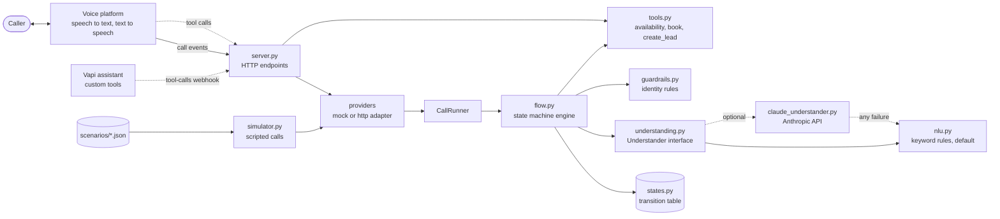
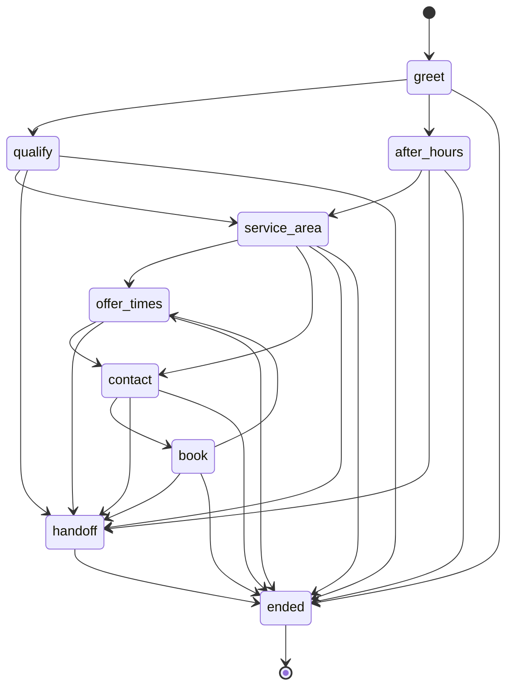

# ai-receptionist-starter

**An AI phone receptionist for home service companies (plumbing, electrical, HVAC, handyman).**

When everyone is out on a job, the phone goes to voicemail, and a missed call is usually a lost job. This project is the working core of an assistant that answers instead. On each call it:

- **Answers and says what it is.** Every call opens with "I'm the automated assistant, not a person." It never pretends to be a human.
- **Qualifies the job.** What is wrong, and is the job in your service area.
- **Books the visit.** Offers open arrival windows, takes a name and callback number, reads it back and books.
- **Hands off cleanly.** If the caller asks for a person, has an emergency, or the assistant cannot follow, it transfers the call and saves what the caller already said, so nobody has to ask twice. After hours it takes a message.

**What this is and is not.** This is a starter: the call logic, the booking tools and a test harness. It is not connected to a phone line. No real voice provider is wired in, there is no audio, and the calendar is an in-memory stand-in. Calls are simulated as text against a mock provider, which is how every path below can be run and checked on a laptop with no accounts or keys. Going live means connecting a voice platform and a real calendar; see [Limitations](#limitations).

**Where the AI is.** Out of the box, caller understanding is keyword rules and no language model is involved. Setting `UNDERSTANDING_BACKEND=claude` hands that one job, working out what the caller said, to Claude through the Anthropic API. The model never decides what happens on the call and never writes a word the caller hears. That code path is covered by offline tests with a fake client; it has not been run against the live API. Details in [Caller understanding](#caller-understanding-keyword-rules-or-claude).

## What you will see

One of the eight simulated calls, copied from [`demo/output.txt`](demo/output.txt) (captured output of `python demo/run_demo.py`). The caller is scripted, the company and the caller are made up, and the bracketed lines show what the software did behind the conversation.

```text
SCENARIO: happy_path_booking
Open hours. Caller with a leaky faucet in the service area books the second
window offered.
Call time: Monday 2030-01-07 10:15 (office open)
Caller ID: +15555550142
------------------------------------------------------------------------------
      [state] greet -> qualify
  ASSISTANT: Thanks for calling Example Home Services. I'm the automated
             assistant, not a person. I can book a service visit or get you to
             someone on the team. What can we help you with today?
  CALLER:    Hi, I have a leaky faucet in my kitchen
      [state] qualify -> service_area
  ASSISTANT: Got it, that sounds like plumbing work. What is the five digit
             ZIP code where the work is needed?
  CALLER:    It's 00102
      [tool] availability {"job_type": "plumbing", "zip_code": "00102", "limit": 3} -> 3 open windows
      [state] service_area -> offer_times
  ASSISTANT: Good news, we cover that area. I have these arrival windows open:
             Tuesday, January 8, between 8 and 10 AM; Tuesday, January 8,
             between 10 AM and 12 PM; Tuesday, January 8, between 1 and 3 PM.
             Which works best? You can also say none of those.
  CALLER:    The second one works
      [state] offer_times -> contact
  ASSISTANT: Tuesday, January 8, between 10 AM and 12 PM, got it. Can I get
             your name?
  CALLER:    My name is Alex Sample
  ASSISTANT: Thanks, Alex Sample. Is 555-555-0142 the best number to reach
             you?
  CALLER:    Yes it is
      [state] contact -> book
  ASSISTANT: To confirm: a plumbing visit, arriving Tuesday, January 8,
             between 10 AM and 12 PM, in ZIP code 00102, under the name Alex
             Sample. Should I book it?
  CALLER:    Yes please
      [tool] book {"slot_id": "2030-01-08T10:00", "job_type": "plumbing", "name": "Alex Sample", "phone": "5555550142", "zip_code": "00102", "description": "Hi, I have a leaky faucet in my kitchen", "idempotency_key": "sim-happy_path_booking:2030-01-08T10:00"} -> booked BK-0001
      [state] book -> ended
  ASSISTANT: You're booked. Your confirmation number is BK-0001. A technician
             will arrive Tuesday, January 8, between 10 AM and 12 PM. Thanks
             for calling Example Home Services. Goodbye.
      [action] hangup
------------------------------------------------------------------------------
OUTCOME: booked
  path:         greet > qualify > service_area > offer_times > contact > book > ended
  confirmation: BK-0001
  lead:         none
  transfer to:  none
  expectations: PASS
```

The other seven calls end differently: out of the service area, a request for a person, an after hours message, an after hours emergency, "are you a real person?", a caller the assistant cannot understand, and a hang up part way through.

The same file also holds four calls through the model path. This excerpt is from one where every caller line is phrased so the keyword rules miss it. Read the `[understanding]` lines with care: the model replies here are hand written and replayed by a fake client (`--understanding recorded`), so this shows what the code does with a reply, not what a real model would answer.

```text
  CALLER:    Water keeps dripping from the tap in my bathroom
      [understanding] model: intent=service_request job_type=plumbing confidence=high
      [state] qualify -> service_area
  ASSISTANT: Got it, that sounds like plumbing work. What is the five digit
             ZIP code where the work is needed?
  CALLER:    We're over in Sampleton, zero zero one zero three
      [understanding] model: intent=give_details zip=00103 place=Sampleton confidence=high
      [tool] availability {"job_type": "plumbing", "zip_code": "00103", "limit": 3} -> 3 open windows
      [state] service_area -> offer_times
```

And from a call where the model step fails four different ways and each turn drops back to the keyword rules:

```text
  CALLER:    My furnace is not heating
      [understanding] keyword rules (model fallback: timeout)
      [state] qualify -> service_area
  ASSISTANT: Got it, that sounds like heating and cooling work. What is the
             five digit ZIP code where the work is needed?
  CALLER:    00101
      [understanding] keyword rules (model fallback: schema_mismatch)
```

## How it is built

Most "AI receptionist" demos are one long prompt, which makes them hard to test and easy to derail. This one is built the other way around, so a call can be tested like any other code.

- **Call flow as a state machine.** Greet, qualify the job, check the service area, offer arrival windows, collect contact details, book, hand off to a human, and a separate after hours path. Every allowed transition is listed in one table in `receptionist/states.py`, and the engine refuses any move that is not in it.
- **Three tools.** `availability`, `book` and `create_lead`, usable in process or over HTTP as endpoints a voice platform calls. Booking is idempotent and rejects double bookings.
- **Understanding behind an interface.** The flow never reads the caller's text for meaning. It asks an `Understander` and gets back plain extracted facts. Two implementations: keyword rules (the default, offline) and Claude (optional). Both feed the same handlers, so every decision is the same code either way.
- **Voice provider adapter.** A small `VoiceProvider` contract with two implementations: a mock that records everything (the default, no key needed), and a generic HTTP adapter whose API shape is an invented example, not a real vendor's. Separately, `vapi_tools.py` exposes the three tools in Vapi's custom tool format, written from Vapi's documentation and not tested against a Vapi account.
- **Call simulator.** Scripted fake calls in `scenarios/*.json` are played through the real flow. It prints the transcript, every state change, every tool call and the outcome, and exits non-zero if a call does not end the way the scenario expects.
- **Identity guardrail.** The first line of every call must contain the disclosure. Any line that matches a "claims to be a person" pattern raises an error before it is spoken. Asking "are you a real person?" gets a straight answer in any state, then the call carries on where it was.
- **Sensible escalation.** Two misses in a row in any state and the assistant stops guessing and hands off. An emergency goes straight to a transfer. Every handoff, hang up and dead end leaves a lead behind with whatever was collected.

## Architecture



The call flow itself, generated from the transition table by `mermaid()` in `receptionist/states.py`:



| State | What happens | Leaves when |
| --- | --- | --- |
| `greet` | Discloses the assistant, routes on business hours | Always, immediately |
| `qualify` | Works out the job type | Job recognised, or two misses (handoff) |
| `after_hours` | Office closed: take a message, or escalate an emergency | Message given |
| `service_area` | Checks the ZIP code | In area, or out of area (call ends, lead saved) |
| `offer_times` | Offers three arrival windows, then three more | Window picked, or nothing fits (callback request) |
| `contact` | Name and callback number | Both collected |
| `book` | Reads the booking back and books on a yes | Booked, or the window was taken (back to offers) |
| `handoff` | Saves a lead, transfers if anyone can answer | Always, immediately |
| `ended` | Terminal | Never |

## Caller understanding: keyword rules or Claude

**What the model does.** For each caller turn it fills one fixed structure: intent, job type, urgency, ZIP code, place name, time preference (position, weekday, morning or afternoon, hour), the caller's name if offered, whether they want a person, and its own confidence. The Anthropic API's structured outputs feature constrains the reply to that JSON schema, and the reply is validated again locally.

**What the model does not do.** It does not choose the next state, check the service area, pick an arrival window, book, apply after hours rules, or decide a handoff. Those are the same deterministic handlers in `flow.py` that the keyword path uses. It also never produces speech: every line a caller hears comes from `prompts.py` and passes the identity guardrail, so no model reply can make the assistant claim to be a person. On top of that:

- If the keyword rules hear an emergency, a request for a person, or "are you a real person?", the model cannot switch that off. It can only add one the rules missed.
- A ZIP or a name from the model is used only if the caller actually said those digits or words. Anything else is dropped as invented.
- Phone numbers are always read by the digit rules.
- On any SDK error, timeout, refusal, cut off or empty reply, reply that fails the schema, or low confidence, that turn is understood by the keyword rules instead, and the call log records the reason.

**Turning it on.**

```bash
pip install anthropic                 # or: pip install ".[claude]"
export ANTHROPIC_API_KEY=...          # read by the Anthropic SDK, not by this code
export UNDERSTANDING_BACKEND=claude
python -m receptionist.server
```

The default model is `claude-haiku-5-5` (set `UNDERSTANDING_MODEL` to change it). Requests use a 4 second timeout (`UNDERSTANDING_TIMEOUT_SECONDS`) and no retries, because on a live call a late answer is worth less than the fallback.

**What leaves the machine when it is on.** One request per caller turn to the Anthropic API, containing exactly:

1. A static system prompt and the output schema (both in `receptionist/claude_understander.py`; neither contains anything about your business or the call).
2. One user message: `{"expecting": "<label>", "utterance": "<the caller's words as transcribed>"}`. The label is one of `job_description`, `after_hours_message`, `zip_code`, `time_choice`, `name`, `phone_confirmation`, `booking_confirmation`.

Not sent: the caller's phone number, earlier turns of the call, the company name, your service ZIP list, offered windows, bookings or leads. The turn where the caller is asked for a phone number is never sent at all. Be clear about the limit of that: the utterance is whatever the caller said, so if they volunteer a name, an address or a number in any other turn, those words go to the API. With the default keyword backend nothing leaves the machine.

**What was tested, and how.**

| | Status |
| --- | --- |
| Keyword path | Tested offline, every scenario and flow path |
| Claude path, this project's code | Tested offline with a fake client replaying hand written replies: success, timeout, connection error, refusal, cut off reply, empty reply, malformed and off schema JSON, low confidence, and hostile replies |
| Claude path, request format | Tested offline through the real Anthropic SDK with its HTTP layer replaced by a mock, when the SDK is installed (CI does this). Confirms the SDK accepts the request and that its typed errors are handled |
| Claude path, live API | **Not exercised.** No API key was available when this was built. Nothing here shows how well the model actually understands callers, how fast it answers, or that the prompt cache hits |

The Anthropic features used were taken from the current API documentation: structured outputs (`output_config.format`), `output_config.effort` set to low, and prompt caching on the system prompt. The system prompt is long enough to clear the 512 token caching minimum documented for the default model, but cache hits were not observed.

## Run it

Python 3.10 or newer. There are no runtime dependencies, so after cloning this works with nothing installed:

```bash
python -m receptionist.simulator
```

That plays all eight scripted calls. To play one, pass its file: `python -m receptionist.simulator scenarios/01_happy_path_booking.json`.

The simulator and the demo take `--understanding` to choose the backend:

| Flag | What runs | Needs |
| --- | --- | --- |
| `--understanding keyword` (default) | The eight calls in `scenarios/`, keyword rules | Nothing |
| `--understanding recorded` | The four calls in `scenarios/model_path/` through the Claude code path, with replies replayed by a fake client | Nothing |
| `--understanding claude` | All twelve calls against the live model | `pip install anthropic` and credentials; sends the scripted caller lines to the Anthropic API |

With the live model the replies can differ between runs, so a scenario's expectations may not hold every time.

To start the HTTP endpoints on `127.0.0.1:8080` with the mock provider:

```bash
python -m receptionist.server
curl http://127.0.0.1:8080/health
```

The server uses the real clock, so the windows it offers are real upcoming dates. The simulator and demo use fixed dates in 2030 so their output never changes.

## Run the tests

The only thing to install is pytest. A virtual environment inside the folder is fine:

```bash
python -m venv .venv
source .venv/bin/activate        # Windows: .venv\Scripts\activate
pip install -r requirements-dev.txt
python -m pytest
```

309 tests, a few seconds, no network and no keys. They cover the language rules, the tools, every path through the flow (including a window being taken between the offer and the confirmation), the guardrail, the understanding interface and the Claude backend with a fake client, both provider adapters, the Vapi tool adapter, the HTTP layer over a real local socket, and every scenario. Nine more tests run when the optional `anthropic` package is installed (318 in total); they push requests through the real SDK into a mock HTTP transport, still with no network and no key. CI runs the suite and the demo without the SDK, then installs it and runs the suite again, on Python 3.10 and 3.12 (`.github/workflows/ci.yml`).

## Demo

```bash
python demo/run_demo.py
```

This runs the eight keyword scenarios, then the four model path scenarios with recorded replies, then calls the tool handlers directly (the same ones the HTTP server exposes), all offline. `python demo/run_demo.py --understanding claude` plays the scenarios against the live model instead. The captured output is in [`demo/output.txt`](demo/output.txt), and a test fails if that file drifts from what the simulator prints. A handoff from it:

```text
  CALLER:    I need an outlet replaced in the garage
      [state] qualify -> service_area
  ASSISTANT: Got it, that sounds like electrical work. What is the five digit
             ZIP code where the work is needed?
  CALLER:    Actually, can I just talk to a real person?
      [state] service_area -> handoff
      [tool] create_lead {"reason": "caller_requested", "job_type": "electrical", "description": "I need an outlet replaced in the garage", "phone": "5555550144", "urgency": "normal"} -> lead LD-0001
      [state] handoff -> ended
  ASSISTANT: Sure, I'll connect you with someone on the team now. Please hold.
      [action] transfer to +15555550100
------------------------------------------------------------------------------
OUTCOME: handed_off
```

"Transfer" here means the mock provider recorded a transfer instruction. No call is placed.

## HTTP endpoints

| Method and path | Purpose |
| --- | --- |
| `GET /health` | Liveness check, no auth |
| `POST /tools/availability` | `{"job_type", "zip", "limit"?, "after"?}` returns open arrival windows |
| `POST /tools/book` | `{"slot_id", "job_type", "name", "phone", "zip", "description"?, "idempotency_key"?}` |
| `POST /tools/create-lead` | `{"reason", "job_type"?, "description"?, "name"?, "phone"?, "zip"?, "urgency"?, "call_id"?}` |
| `POST /voice/events` | Call started, caller utterance and call ended events, answered by the state machine |
| `POST /vapi/tools` | The three tools in Vapi's custom tool format (see below) |

There are two ways to use this with a voice platform. Either the platform sends each transcribed caller turn to `/voice/events` and speaks whatever comes back, so the state machine is in charge. Or the platform runs its own conversation and only calls the three `/tools/*` endpoints. The tests exercise both over HTTP. With the mock provider, a call event looks like `{"type": "call.started", "call_id": "c1", "from": "+15555550142"}`, then `{"type": "caller.utterance", "call_id": "c1", "text": "..."}`, then `{"type": "call.ended", "call_id": "c1"}`.

**Vapi custom tools.** `POST /vapi/tools` accepts Vapi's `tool-calls` server message (`message.toolCallList[]` with `id` and `function.name` / `function.arguments`) and answers the way Vapi's documentation requires: HTTP 200 with `{"results": [{"toolCallId": "...", "result": "<single line string>"}]}`, or `"error"` in place of `"result"` for a call that failed. Function names are `check_availability`, `book_appointment` and `create_lead`, with the same arguments as the `/tools/*` endpoints. This adapter was written from [Vapi's custom tools documentation](https://docs.vapi.ai/tools/custom-tools) and its tests use payloads shaped like the examples there. It has not been tested against a live Vapi account. In this mode Vapi's own model runs the conversation, so the state machine and its guarantees (the disclosure, the deterministic handoff) are not in play; you would have to configure those in the Vapi assistant.

Errors on the other endpoints come back as `{"error": "<code>", "message": "..."}` with a matching status: 400 for bad input, 401 for a missing or wrong secret, 404 for an unknown window or call, 409 when a window was just taken, 422 when booking a ZIP outside the service area (`availability` answers that case with 200 and `"in_service_area": false`).

## Configuration

Copy `.env.example` to `.env` and export it in your shell. Everything is optional; with nothing set you get the mock provider and the synthetic defaults.

| Variable | Default | Meaning |
| --- | --- | --- |
| `VOICE_PROVIDER` | `mock` | `mock` or `http` |
| `VOICE_API_KEY` | empty | Required only when `VOICE_PROVIDER=http` |
| `VOICE_API_BASE_URL` | `https://voice.example.com/v1` | Base URL of the platform's control API |
| `UNDERSTANDING_BACKEND` | `keyword` | `keyword` (offline rules) or `claude` (Anthropic API) |
| `UNDERSTANDING_MODEL` | `claude-haiku-5-5` | Model id, used only with `claude` |
| `UNDERSTANDING_TIMEOUT_SECONDS` | `4` | Per request timeout, used only with `claude` |
| `ANTHROPIC_API_KEY` | empty | Read by the Anthropic SDK when the backend is `claude` |
| `TOOL_SHARED_SECRET` | empty | When set, every POST must send it as `X-Tool-Secret` |
| `COMPANY_NAME` | `Example Home Services` | Name used in the greeting |
| `SERVICE_ZIPS` | `00101,00102,00103,00104` | Comma separated ZIP codes served |
| `HANDOFF_NUMBER`, `ON_CALL_NUMBER` | 555-01xx numbers | Where transfers go |
| `HOST`, `PORT` | `127.0.0.1`, `8080` | Where the server listens |

Business hours, arrival windows and crew capacity are fields on `BusinessConfig` in `receptionist/config.py`.

## Layout

```text
receptionist/
  states.py       State enum and the transition table
  flow.py         Engine: one handler per state, handoff, retries, call log
  understanding.py         Understander interface, keyword backend, backend choice
  claude_understander.py   Claude backend: prompt, schema, validation, fallback
  nlu.py          Keyword rules for caller utterances
  prompts.py      Every line the assistant can say
  guardrails.py   Identity rules enforced on every outgoing line
  tools.py        availability, book, create_lead with an in-memory store
  server.py       HTTP endpoints (standard library)
  simulator.py    Plays scripted calls and checks their outcomes
  providers/      VoiceProvider contract, mock, generic HTTP adapter, CallRunner
  vapi_tools.py   The three tools in Vapi's custom tool format (from its docs)
scenarios/        Scripted fake calls as JSON
  model_path/     Calls for the Claude code path, with recorded replies
demo/             Demo script and its captured output
tests/            pytest suite
```

## Where this pattern runs

This starter is drawn from systems that run two small service companies day to day, where an assistant answers the phone, books what it safely can and passes everything else to a person with the details already written down. The parts that mattered most there are the parts kept here: a flow you can read as a table, a hard rule about saying what the assistant is, and a handoff that never drops what the caller already said. All names, numbers, ZIP codes and wording in this repository are synthetic.

## Limitations

- **By default the language understanding is keyword rules.** They are deterministic and testable, and they miss plenty of real phrasing. A caller who says "the thing under the sink is dripping" is fine; one who describes a problem without any of the known words gets handed off after two tries.
- **The Claude backend has never called the live API.** It was written against the current Anthropic documentation and tested with fakes, including through the real SDK with a mock HTTP layer. Whether the model reads real callers well, whether the prompt and schema need tuning, how long a turn takes, and whether the prompt cache hits are all unmeasured. Expect to adjust it on first contact with real traffic.
- **The model path adds latency and a dependency to every turn.** Each caller turn waits for one API round trip, up to the timeout (4 seconds by default) before falling back. That is a long pause on a phone call. There is no streaming, no speculative keyword answer while waiting, and no circuit breaker that stops calling the API after repeated failures.
- **The model's confidence is self reported.** Low confidence triggers the fallback, but nothing checks that a confident reply is right. A confident wrong job type or a confident wrong "yes" is acted on. The read back before booking is the only check on that.
- **The model sees one turn at a time.** It gets the current utterance and a label for what was asked, not the conversation. That keeps what is sent small, and it means the model cannot resolve "the same as I said before".
- **A place name is noted, not used.** If a caller names a town instead of a ZIP, the assistant still asks for the ZIP. There is no town to ZIP lookup.
- **Caller words go to a third party when the model is on.** See [what leaves the machine](#caller-understanding-keyword-rules-or-claude). Whether that is acceptable for your callers, and what notice or consent it needs where you operate, is not something this code decides.
- **No real voice provider is wired in, and there is no audio.** Nothing here has answered a real phone call. This starts at text. Speech to text, text to speech, barge in and latency are the voice platform's job and are not simulated.
- **The HTTP provider is a generic example.** Its payload and endpoint shapes are invented, not any vendor's API. It is tested only against a fake transport.
- **The Vapi adapter is written from documentation only.** It covers custom tool calls, not Vapi's other server messages, and it has never received a request from Vapi. Field names and response rules follow Vapi's public docs as read in November 2026 and may drift.
- **The identity guardrail is a pattern check.** It is airtight for the fixed lines in `prompts.py`, which is all the assistant can say, with or without the model backend. If you let a model write the replies, it becomes a backstop that catches the listed phrasings, not a guarantee.
- **Storage is in memory.** Bookings, leads and call sessions vanish on restart and are not shared between processes. A real deployment needs a database and a calendar or dispatch system behind `tools.py`.
- **Scheduling is simplified.** Fixed two hour windows, one shared capacity number, no per trade crews, no travel time, no same day slots, no holidays.
- **Time is naive local time.** There is no timezone handling.
- **Shared secret auth only.** There is no webhook signature check, rate limit or TLS; put it behind a proxy that does those.
- **US formats only.** Five digit ZIP codes and ten digit phone numbers, English only.
- **The emergency list is short and not safety reviewed.** It routes to a transfer and reads a 911 line; it is not a substitute for a real emergency policy.
- **Not load tested.** The server is the standard library threading server, fine for a demo and for tests.

License: MIT, see the LICENSE file.
